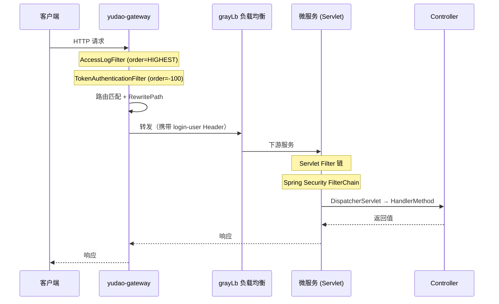
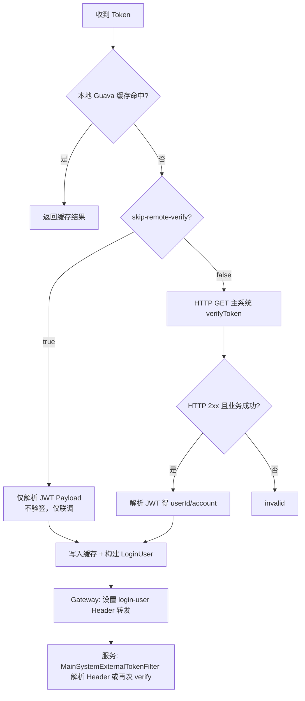
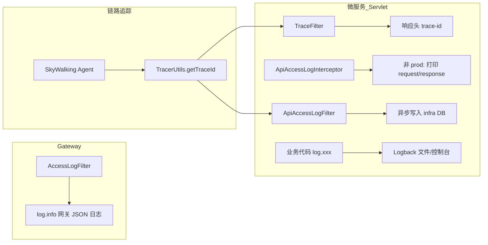

````
# 项目架构与请求全流程梳理

> 基于 CodeGraph 索引（2028 文件 / 37185 节点）与源码交叉验证整理。  
> 仓库为 **芋道 yudao-cloud** 微服务脚手架 + **gzmap-parent** 业务服务扩展。

---

## 1. 项目整体结构

```
special-bond-accessibility-platform-back/
├── yudao-gateway/              # Spring Cloud Gateway 统一入口（端口 48080）
├── yudao-framework/            # 自研 Starter 与公共能力（security / web / redis / mybatis …）
├── yudao-module-*/             # 芋道业务模块（system / infra / bpm / report / ai …）
├── yudao-server/               # 单体聚合启动（可选）
└── gzmap-parent/               # 专项债可达性平台业务微服务
    ├── analysis-service/
    ├── community-service/
    ├── construct-service/
    ├── detail-service/
    ├── infra-service/
    ├── monitor-service/
    ├── plan-service/
    ├── stat-service/
    ├── trans-service/
    └── gzmap-main-system-auth/ # 主系统 Token 鉴权 Starter
```

### 1.1 两类 API 路径体系

| 体系 | 对外前缀（经 Gateway） | 服务内前缀 | 鉴权方式 |
|------|------------------------|------------|----------|
| 芋道管理端 | `/admin-api/{module}/**` | Controller 无额外前缀（由 `WebProperties` 自动加 `/admin-api`） | OAuth2 Token → `system-server` 校验 |
| 芋道用户端 | `/app-api/{module}/**` | 同上 | OAuth2 Token |
| **gzmap 业务** | `/gzmap/api/{service}/**` | `/api/{service}/**` | 主系统 JWT → `verifyToken` |

Gateway 对 gzmap 路由会做路径重写，例如：

```
/gzmap/api/analysis/taz/metrics  →  gjy-analysis-service  →  /api/analysis/taz/metrics
```

---

## 2. HTTP 请求处理全流程

### 2.1 总览时序



### 2.2 Gateway 层（WebFlux / Reactive）

**入口文件**：`yudao-gateway/src/main/resources/application.yaml`

处理顺序（按 `Ordered` 值，越小越先执行）：

| 顺序 | 组件 | 职责 |
|------|------|------|
| `HIGHEST_PRECEDENCE` | `AccessLogFilter` | 记录网关访问日志（控制台 JSON） |
| `-100` | `TokenAuthenticationFilter` | Token 校验，写入 `login-user` Header |
| 路由级 | `RewritePath` 等 | 路径改写、Swagger 文档转发 |
| 默认 | `grayLb://` | 灰度负载均衡转发到 Nacos 注册实例 |

**路由示例**（gzmap）：

```yaml
- id: gzmap-analysis-admin-api
  uri: grayLb://gjy-analysis-service
  predicates:
    - Path=/gzmap/api/analysis/**
  filters:
    - 'RewritePath=/gzmap/api/analysis/(.*), /api/analysis/$1'
```

### 2.3 微服务层（Servlet / Spring MVC）

以 `analysis-service-biz` 为例，请求进入 Tomcat 后经过多层 Filter，最终到达 Controller。

#### Servlet Filter 执行顺序（`WebFilterOrderEnum`）

| Order | Filter | 来源 Starter | 说明 |
|-------|--------|--------------|------|
| `MIN_VALUE` | `CorsFilter` | web | 跨域 |
| `MIN+1` | `TraceFilter` | monitor（可选） | 响应头写入 `trace-id` |
| `MIN+500` | `CacheRequestBodyFilter` | web | 请求体可重复读 |
| `-104` | `TenantContextWebFilter` | tenant（可选） | 多租户上下文 |
| `-103` | `ApiAccessLogFilter` | web | **仅 `/admin-api`、`/app-api`** |
| `-102` | `XssFilter` | web | XSS 过滤 |
| `-100` | Spring Security 链 | security | 见下文 |
| `-99` | `TenantSecurityWebFilter` | tenant（可选） | 租户安全校验 |

> **注意**：gzmap 业务接口路径为 `/api/**`，不在 `ApiRequestFilter` 的过滤范围内，因此 **不会走** `ApiAccessLogFilter` 的 DB 落库逻辑，主要依赖 Logback 控制台/文件日志。

#### Spring MVC 阶段

1. `DispatcherServlet` 根据 `@RequestMapping` 匹配 Handler  
2. `ApiAccessLogInterceptor`（非 prod）打印 request/response 调试日志  
3. Controller 执行业务逻辑  
4. `GlobalResponseBodyHandler` 拦截 `CommonResult` 返回值，写入 request 属性供访问日志使用  
5. `GlobalExceptionHandler` 统一异常转 `CommonResult`

**gzmap Controller 示例**：

```java
@RestController
@RequestMapping("/api/analysis/taz")
public class GzmapTazInfoController { ... }
```

---

## 3. Token 处理逻辑

项目存在 **两套并行** 的 Token 鉴权体系，Gateway 按路径前缀分流。

### 3.1 分流规则（Gateway）

`TokenAuthenticationFilter.filter()` 逻辑：

```
if (gzmap.security.main-system.enabled && path.startsWith("/gzmap/api/"))
    → filterGzmapMainSystem()   // 主系统 Token，无效直接 401
else
    → filterOAuth2()            // 芋道 OAuth2，无效则匿名放行
```

### 3.2 主系统 Token（gzmap 路径）

#### Token 获取优先级

Gateway：`SecurityFrameworkUtils.obtainMainSystemToken()`

1. Header `Token-auth`
2. Header `Authorization: Bearer <token>`
3. Query `?token=`

服务侧兜底：`MainSystemTokenResolver.resolve()`（逻辑相同）

#### 校验流程



**关键类**：

| 层级 | 类 | 路径 |
|------|-----|------|
| Gateway 校验 | `TokenAuthenticationFilter` | `yudao-gateway/.../filter/security/` |
| HTTP 客户端 | `MainSystemTokenClient` | `gzmap-main-system-auth/.../client/` |
| 服务侧 Filter | `MainSystemExternalTokenFilter` | `gzmap-main-system-auth/.../filter/` |
| Security 链 | `GzmapMainSystemServletAutoConfiguration` | 仅匹配 `/api/**` |

**LoginUser 透传**：

- Gateway 校验通过后，将 `LoginUser` JSON 写入请求头 `login-user`（URL 编码）
- 下游 `MainSystemExternalTokenFilter` 优先读 Header，避免重复远程调用
- 校验通过后调用 `SecurityFrameworkUtils.setLoginUser()` 写入 Spring Security 上下文
- 同时向 MDC 写入 `userId`、`account` 便于日志关联

**401 响应体**（主系统 Token 无效）：

```json
{
  "code": 401,
  "msg": "主系统 Token 无效或已过期",
  "data": { "loginRedirectUrl": "https://..." }
}
```

### 3.3 芋道 OAuth2 Token（admin-api / app-api 路径）

#### Token 获取

`SecurityFrameworkUtils.obtainAuthorization()`：

1. Header `Authorization`（支持 `Bearer ` 前缀）
2. Query 参数（配置项 `yudao.security.token-parameter`）

#### Gateway 校验

- 调用 `http://system-server/admin-api/system/oauth2/token/check?accessToken=xxx`（经 `grayLb`）
- 本地 Guava 缓存 1 分钟（key = tenantId + token）
- 校验成功 → 写 `login-user` Header；失败或过期 → **不拦截**，匿名继续（由下游 Security 决定是否 401）

#### 微服务校验（`yudao-spring-boot-starter-security`）

`TokenAuthenticationFilter`（Servlet）处理顺序：

1. **优先** 读 `login-user` Header（来自 Gateway 透传）
2. 若无，则读 Token 调 `OAuth2TokenCommonApi.checkAccessToken()`（Feign → system-server）
3. 开发环境可启用 `yudao.security.mock-enable` + mockSecret 模拟登录

#### Spring Security 授权规则（`YudaoWebSecurityConfigurerAdapter`）

1. 静态资源、`@PermitAll` 注解接口 → 免登录
2. `yudao.security.permit-all-urls` 配置 → 免登录
3. 各模块 `AuthorizeRequestsCustomizer` 自定义规则
4. **兜底**：`anyRequest().authenticated()`

---

## 4. 配置文件生效逻辑

### 4.1 加载顺序（Spring Boot 3）

Spring Boot 3 使用 `spring.config.import` 替代旧版 `bootstrap.yml`。

#### Gateway 示例

```yaml
# application.yaml
spring:
  profiles:
    active: local
  config:
    import:
      - optional:classpath:application-${spring.profiles.active}.yaml
      - optional:nacos:${spring.application.name}-${spring.profiles.active}.yaml
```

#### gzmap 微服务示例（analysis-service）

```yaml
spring:
  application:
    name: gjy-analysis-service
  config:
    import:
      - optional:classpath:application-gzmap-main-system-gateway.yaml
      - optional:nacos:common.yaml?group=DEFAULT_GROUP
      - optional:nacos:${spring.application.name}-${spring.profiles.active}.yaml
```

**生效优先级**（后导入覆盖先导入）：

```
application.yaml（基础）
  → application-{profile}.yaml（环境差异：Nacos 地址、namespace）
    → application-gzmap-main-system-gateway.yaml（主系统鉴权开关）
      → Nacos common.yaml（公共 Redis/DB 等）
        → Nacos {app}-{profile}.yaml（服务专属配置）
```

`optional:` 前缀表示文件/配置不存在时不报错。

### 4.2 Nacos 配置中心

| 配置项 | 作用 |
|--------|------|
| `spring.cloud.nacos.server-addr` | Nacos 地址 |
| `spring.cloud.nacos.config.namespace` | 配置命名空间 |
| `spring.cloud.nacos.config.group` | 配置分组（默认 `DEFAULT_GROUP`） |
| `spring.cloud.nacos.discovery.*` | 服务注册（与 config 可共用 namespace） |

Nacos 配置变更后，标注 `@RefreshScope` 的 Bean 可热更新；普通 `@ConfigurationProperties` 需配合 `@RefreshScope` 或重启。

### 4.3 主系统鉴权配置

文件：`gzmap-main-system-auth/src/main/resources/application-gzmap-main-system-gateway.yaml`

```yaml
gzmap:
  security:
    main-system:
      enabled: true
      base-url: https://ghjd.gzlpc.gov.cn
      verify-token-path: /sys-system/auth/token/verifyToken
      login-redirect-url: https://ghjd.gzlpc.gov.cn/sps
      cache-seconds: 300
      http-timeout-ms: 10000
      skip-remote-verify: false   # 联调可 true，生产必须 false
```

绑定到 `GzmapMainSystemSecurityProperties`（`@ConfigurationProperties(prefix = "gzmap.security.main-system")`）。

### 4.4 日志文件路径

```yaml
logging:
  file:
    name: ${user.home}/logs/${spring.application.name}.log
```

配合 `logback-spring.xml` 滚动策略（按天 + 10MB 分割，保留 30 天）。

---

## 5. 日志打印逻辑流程

### 5.1 日志框架栈

```
SLF4J API
  └── Logback（logback-spring.xml）
        ├── STDOUT Appender（控制台）
        ├── ASYNC → FILE Appender（异步写文件）
        └── SKYWALKING Appender（可选，GRPC 上报）
```

### 5.2 三层日志机制



### 5.3 各组件职责

| 组件 | 触发条件 | 输出目标 | 关键字段 |
|------|----------|----------|----------|
| `AccessLogFilter`（Gateway） | 所有经网关请求 | 控制台 `log.info` | userId, routeId, requestUrl, body, duration |
| `TraceFilter` | `yudao.tracer.enable=true`（默认） | 响应 Header `trace-id` | SkyWalking TraceId |
| `ApiAccessLogInterceptor` | 非 prod 环境 | 控制台 | URL、参数、耗时 |
| `ApiAccessLogFilter` | `/admin-api` 或 `/app-api` | DB（经 Feign 调 infra） | traceId, userId, 请求/响应、操作模块 |
| `MainSystemExternalTokenFilter` | gzmap `/api/**` | MDC | userId, account |
| 业务 `@Slf4j` | 任意 | Logback | 自定义 |

### 5.4 ApiAccessLogFilter 落库流程

1. Filter 开始时缓存 query/body（在 XSS 过滤前）
2. `filterChain.doFilter()` 执行业务
3. 从 request 属性取 `HandlerMethod`（由 Interceptor 写入）
4. 读取 `@ApiAccessLog` 注解控制是否记录、脱敏字段
5. `apiAccessLogApi.createApiAccessLogAsync()` 异步写库
6. 敏感字段脱敏：`password`, `token`, `accessToken`, `refreshToken`

### 5.5 gzmap 服务日志特点

- 路径 `/api/**` 不走 `ApiAccessLogFilter`
- 鉴权 Filter 会向 MDC 写入用户信息
- 依赖 `logging.file.name` + `logback-spring.xml` 做持久化
- Gateway 侧 `AccessLogFilter` 仍会记录完整网关日志（含 gzmap 路由）

---

## 6. 依赖引入与生效逻辑

### 6.1 Maven 依赖管理

```
根 pom.xml
  └── import yudao-dependencies（BOM 统一版本）
        └── 各 module / starter 只声明 groupId + artifactId
```

### 6.2 Starter 机制（Spring Boot 3）

每个 `yudao-spring-boot-starter-*` 在以下路径注册自动配置：

```
META-INF/spring/org.springframework.boot.autoconfigure.AutoConfiguration.imports
```

启动时 Spring Boot 读取该文件，加载 `@AutoConfiguration` 类。

### 6.3 以 analysis-service-biz 为例的依赖链

```xml
<!-- 直接依赖 -->
yudao-spring-boot-starter-web
yudao-spring-boot-starter-security
yudao-spring-boot-starter-redis
gzmap-main-system-auth
spring-cloud-starter-alibaba-nacos-discovery
spring-cloud-starter-alibaba-nacos-config
mybatis-plus-spring-boot3-starter
```

**传递生效关系**：

```
yudao-spring-boot-starter-security
  └── yudao-spring-boot-starter-web（传递）
        └── spring-boot-starter-web
        └── yudao-common

yudao-spring-boot-starter-security 激活：
  ├── YudaoSecurityAutoConfiguration      → TokenAuthenticationFilter Bean
  ├── YudaoWebSecurityConfigurerAdapter   → SecurityFilterChain（/admin-api 等）
  └── YudaoSecurityRpcAutoConfiguration   → Feign OAuth2TokenCommonApi

gzmap-main-system-auth 激活（需 gzmap.security.main-system.enabled=true）：
  ├── GzmapMainSystemCoreAutoConfiguration    → MainSystemTokenClient
  └── GzmapMainSystemServletAutoConfiguration → MainSystemExternalTokenFilter
                                                 + SecurityFilterChain（/api/**）
```

### 6.4 主要 Starter 自动配置一览

#### yudao-spring-boot-starter-web

| 自动配置类 | 生效条件 | 注册内容 |
|------------|----------|----------|
| `YudaoWebAutoConfiguration` | 始终 | 全局异常、CORS、RequestBody 缓存、`/admin-api` 前缀 |
| `YudaoApiLogAutoConfiguration` | `yudao.access-log.enable`（默认 true） | ApiAccessLogFilter + Interceptor |
| `YudaoXssAutoConfiguration` | `yudao.xss.enable`（默认 true） | XssFilter |
| `YudaoSwaggerAutoConfiguration` | 始终 | Knife4j / OpenAPI |
| `YudaoJacksonAutoConfiguration` | 始终 | JSON 序列化配置 |

#### yudao-spring-boot-starter-security

| 自动配置类 | 注册内容 |
|------------|----------|
| `YudaoSecurityAutoConfiguration` | TokenAuthenticationFilter、PasswordEncoder、`@ss` 权限服务 |
| `YudaoWebSecurityConfigurerAdapter` | 默认 SecurityFilterChain |
| `YudaoOperateLogConfiguration` | 操作日志 AOP |

#### yudao-spring-boot-starter-monitor

| 自动配置类 | 生效条件 | 注册内容 |
|------------|----------|----------|
| `YudaoTracerAutoConfiguration` | classpath 有 SkyWalking + `yudao.tracer.enable` | TraceFilter |

#### gzmap-main-system-auth

| 自动配置类 | 生效条件 | 注册内容 |
|------------|----------|----------|
| `GzmapMainSystemCoreAutoConfiguration` | 始终（引入 jar 即加载） | `MainSystemTokenClient` |
| `GzmapMainSystemServletAutoConfiguration` | Servlet 应用 + `enabled=true` | `/api/**` 专用 SecurityFilterChain |

### 6.5 条件装配要点

| 注解 / 机制 | 示例 |
|-------------|------|
| `@ConditionalOnProperty` | `gzmap.security.main-system.enabled=true` 才启用主系统鉴权链 |
| `@ConditionalOnWebApplication(SERVLET)` | Gateway（Reactive）不加载 Servlet 鉴权 Filter |
| `@ConditionalOnClass` | 有 SkyWalking 类才注册 TraceFilter |
| `@AutoConfiguration(after/before)` | 控制配置类加载顺序 |
| `@Order` on SecurityFilterChain | gzmap 链 `@Order(1)`，与默认芋道链并存 |

### 6.6 Gateway 依赖特点

Gateway 为 **WebFlux**，不引入 `yudao-spring-boot-starter-security`，而是：

- 直接依赖 `gzmap-main-system-auth`（仅 `GzmapMainSystemCoreAutoConfiguration` + Gateway 自写 `TokenAuthenticationFilter`）
- `GzmapMainSystemServletAutoConfiguration` 因 `@ConditionalOnWebApplication(SERVLET)` **不会**在 Gateway 生效

---

## 7. 典型请求路径对照

### 7.1 gzmap 业务请求

```
GET /gzmap/api/analysis/taz/metrics?fields=xxx
Authorization: Bearer <主系统JWT>

① Gateway AccessLogFilter 开始记录
② Gateway TokenAuthenticationFilter
   - verifyToken → LoginUser
   - 添加 Header: login-user
③ 路由 gzmap-analysis-admin-api → gjy-analysis-service
④ RewritePath → /api/analysis/taz/metrics
⑤ MainSystemExternalTokenFilter
   - 读 login-user Header → setLoginUser → MDC
⑥ GzmapTazInfoController.metrics()
⑦ 返回 R<T> / CommonResult
⑧ Gateway AccessLogFilter 打印完整 JSON 日志
```

### 7.2 芋道管理端请求

```
GET /admin-api/system/user/profile
Authorization: Bearer <OAuth2 accessToken>
tenant-id: 1

① Gateway TokenAuthenticationFilter (OAuth2 分支)
   - checkAccessToken via system-server
   - login-user Header
② 路由 system-admin-api → system-server
③ Servlet Filter 链（含 ApiAccessLogFilter）
④ TokenAuthenticationFilter 读 login-user
⑤ Spring Security 鉴权 + @PreAuthorize
⑥ Controller → CommonResult
⑦ ApiAccessLogFilter 异步落库
```

---

## 8. 关键源码索引

| 主题 | 文件 |
|------|------|
| Gateway 路由 | `yudao-gateway/src/main/resources/application.yaml` |
| Gateway Token | `yudao-gateway/.../TokenAuthenticationFilter.java` |
| Gateway 访问日志 | `yudao-gateway/.../AccessLogFilter.java` |
| Servlet Token | `yudao-framework/.../security/.../TokenAuthenticationFilter.java` |
| Security 规则 | `yudao-framework/.../YudaoWebSecurityConfigurerAdapter.java` |
| 主系统鉴权 | `gzmap-parent/gzmap-main-system-auth/` |
| Filter 顺序 | `yudao-framework/yudao-common/.../WebFilterOrderEnum.java` |
| API 访问日志 | `yudao-framework/.../apilog/.../ApiAccessLogFilter.java` |
| 链路追踪 | `yudao-framework/.../tracer/.../TraceFilter.java` |
| OAuth2 RPC | `yudao-framework/yudao-common/.../OAuth2TokenCommonApi.java` |
| 自动配置注册 | 各 starter 的 `META-INF/spring/org.springframework.boot.autoconfigure.AutoConfiguration.imports` |
| Logback | `yudao-module-infra/.../logback-spring.xml`（各服务可复用） |

---

## 9. 调试与排查建议

1. **401 主系统 Token**：查 Gateway 日志、`MainSystemTokenClient` warn/error、Nacos 中 `gzmap.security.main-system.*` 配置  
2. **401 芋道接口**：查 `system-server` OAuth2 token 是否过期、租户 Header `tenant-id`  
3. **配置不生效**：确认 `spring.profiles.active`、Nacos DataId 命名、`optional:` 是否掩盖了缺失配置  
4. **日志无 traceId**：需部署 SkyWalking Agent；Gateway 侧 AccessLogFilter 仍有 TODO traceId  
5. **gzmap 接口无 DB 访问日志**：属预期行为，查 Logback 文件或 Gateway 访问日志  

---

*文档生成时间：2026-06-12*
````